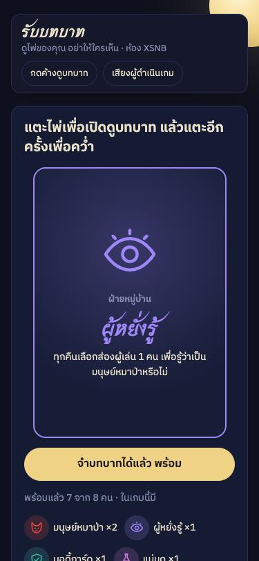
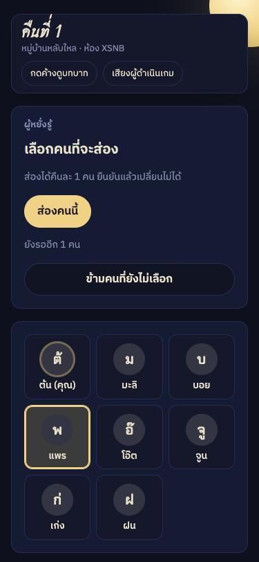
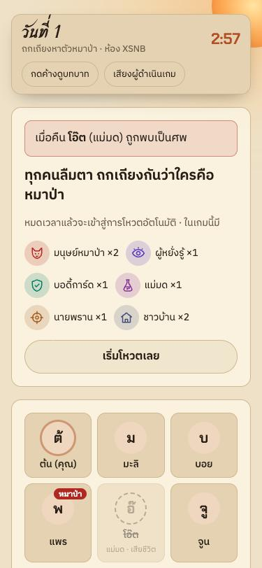

# มนุษย์หมาป่า (Werewolf)

เกมมนุษย์หมาป่าบนเว็บ เล่นได้ 5–16 คน ทุกคนใช้มือถือของตัวเอง ส่วนเว็บเป็นผู้ดำเนินเกม (แจกไพ่ เรียกกลางคืน นับโหวต ตัดสินผลแพ้ชนะ)

**เล่นเลย: https://werewolf-party-pkqs.onrender.com**

[](https://render.com/deploy?repo=https://github.com/Panuwatko/werewolf-party)

<p>
  
  
  
  
</p>

## วิธีเปิดเล่น

ต้องมี Node.js 18 ขึ้นไป ไม่ต้องติดตั้งแพ็กเกจเพิ่ม

```bash
npm start
```

- เครื่องที่เปิดเซิร์ฟเวอร์เข้าที่ `http://localhost:3000`
- เพื่อนที่ต่อ Wi-Fi เดียวกันสแกน QR ในห้องรอ หรือเปิดลิงก์ `http://<IP เครื่องนี้>:3000/?room=XXXX` (ตอนเริ่มเซิร์ฟเวอร์ IP จะแสดงใน terminal)
- เปลี่ยนพอร์ตได้ด้วย `PORT=8080 npm start`

## เล่นออนไลน์จากเครื่องตัวเอง (ไม่ต้องอยู่ Wi-Fi เดียวกัน)

ใช้ Cloudflare Tunnel แบบฟรี ไม่ต้องสมัครบัญชี

```bash
brew install cloudflared   # ติดตั้งครั้งเดียว
npm run online
```

terminal จะขึ้นลิงก์ `https://xxxx.trycloudflare.com` ส่งให้เพื่อนเปิดได้จากทุกที่ QR ในห้องรอจะเปลี่ยนเป็นลิงก์นี้ให้เอง ลิงก์ใช้ได้ตราบที่เครื่องนี้เปิดอยู่และยังไม่กด Ctrl+C (เปิดใหม่จะได้ลิงก์ใหม่)

## Deploy ขึ้นเน็ต (ลิงก์ถาวร)

กดปุ่ม **Deploy to Render** ด้านบน (ใช้ `render.yaml` ในโปรเจกต์ แพ็กฟรี) แล้วเข้าสู่ระบบด้วย GitHub ได้ลิงก์ `https://werewolf-party-xxxx.onrender.com` ส่งให้เพื่อนเปิดได้จากทุกที่

แพ็กฟรีของ Render จะพักเครื่องเมื่อไม่มีคนใช้ 15 นาที เปิดครั้งแรกหลังพักต้องรอราว 30 วินาที และห้องที่ค้างอยู่จะหายไปตอนพัก

โฮสต์อื่นที่รัน Node แบบเครื่องเดียวได้ (Railway, Fly.io) ก็ใช้คำสั่ง `npm start` ได้เหมือนกัน แต่ไม่ควรใช้แบบ serverless (เช่น Vercel functions) เพราะเกมเก็บสถานะห้องไว้ในหน่วยความจำของเซิร์ฟเวอร์

## บทบาท

| บทบาท | ฝ่าย | ความสามารถ |
|---|---|---|
| มนุษย์หมาป่า | หมาป่า | ทุกคืนเลือกเหยื่อร่วมกับเพื่อนหมาป่า (เสียงข้างมาก เสมอกันสุ่ม) |
| ผู้หยั่งรู้ | หมู่บ้าน | ทุกคืนส่อง 1 คน รู้ว่าเป็นหมาป่าหรือไม่ |
| บอดี้การ์ด | หมู่บ้าน | ทุกคืนปกป้อง 1 คน (ปกป้องตัวเองได้ ห้ามซ้ำคนเดิมสองคืนติด) |
| แม่มด | หมู่บ้าน | เห็นว่าใครถูกกัด มียาชุบชีวิตและยาพิษอย่างละ 1 ขวดต่อเกม |
| นายพราน | หมู่บ้าน | เมื่อตาย ยิงพาอีก 1 คนไปด้วย |
| ชาวบ้าน | หมู่บ้าน | ไม่มีพลังพิเศษ |

## ลำดับเกม

1. **รับบทบาท** ทุกคนเปิดไพ่บนมือถือตัวเอง หมาป่าเห็นเพื่อนหมาป่า
2. **กลางคืน** ทุกคนแตะเลือกพร้อมกัน (คนที่ไม่มีพลังก็แตะเลือกคนที่สงสัยไว้พรางตัว) จากนั้นเรียกแม่มด ถ้ามีแม่มดในเกม ระบบจะหน่วงเวลาไว้แม้แม่มดตายแล้ว เพื่อไม่ให้ใครรู้
3. **รุ่งเช้า** ประกาศผู้ตาย (เปิดบทบาทถ้าตั้งไว้) แล้วถกเถียงตามเวลาที่ตั้ง
4. **ลงมติ** เสียงมากสุดถูกประหาร ถ้าเสมอหรืองดออกเสียงมากสุด ไม่มีใครตาย
5. วนจนมีฝ่ายชนะ: หมู่บ้านชนะเมื่อหมาป่าตายหมด หมาป่าชนะเมื่อมีจำนวนเท่ากับหรือมากกว่าฝ่ายหมู่บ้าน

หัวห้องมีปุ่มข้ามขั้นตอน (เช่น มีคนหลุดหรือไม่ยอมเลือก) และกดเล่นรอบใหม่ได้เมื่อจบเกม

## ฟีเจอร์เพิ่มเติม

- กดค้างที่ "ดูบทบาท" เพื่อแอบดูไพ่ ปล่อยแล้วซ่อนทันที
- "เสียงผู้ดำเนินเกม" อ่านประกาศเป็นภาษาไทยด้วยเสียงสังเคราะห์ของเบราว์เซอร์ (เปิดบนเครื่องเดียวที่วางกลางวงก็พอ)
- ปิดแท็บแล้วกลับมาได้ หน้าแรกจะมีปุ่ม "กลับเข้าห้อง"
- เซิร์ฟเวอร์ส่งให้แต่ละคนเฉพาะข้อมูลที่คนนั้นควรรู้ เปิด DevTools ก็ไม่เห็นบทบาทคนอื่น

## โครงสร้าง

- `server.js` เซิร์ฟเวอร์และกติกาเกมทั้งหมด (HTTP + Server-Sent Events)
- `public/` หน้าเว็บ (`index.html`, `style.css`, `app.js`)

ข้อมูลห้องเก็บในหน่วยความจำ ถ้ารีสตาร์ตเซิร์ฟเวอร์ ห้องที่เล่นอยู่จะหายไป
